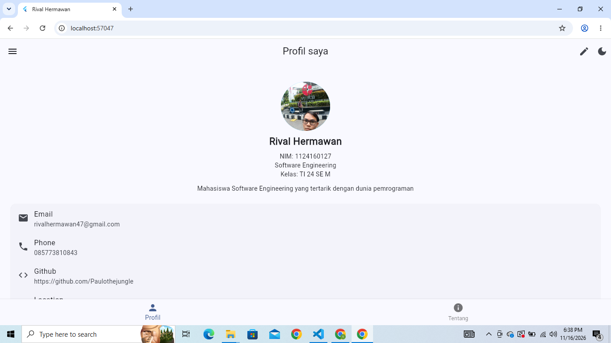
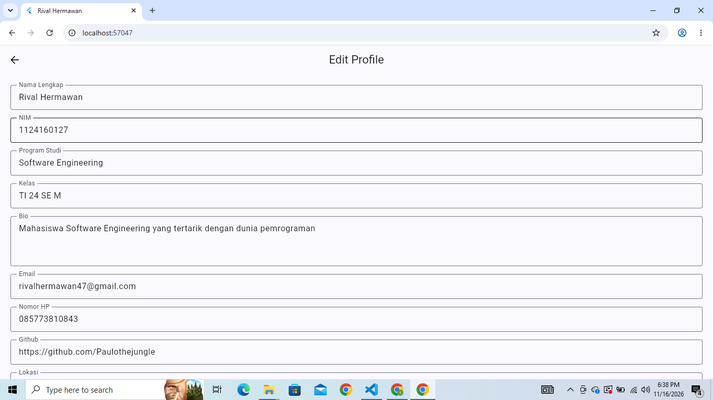
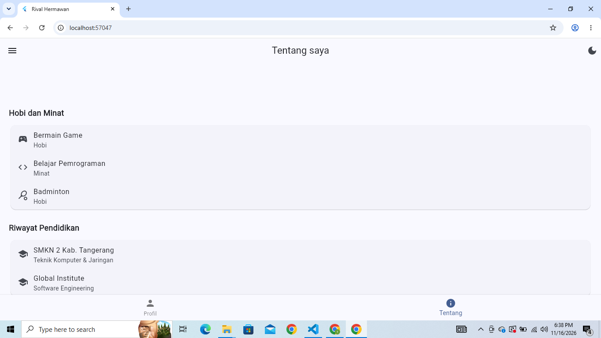
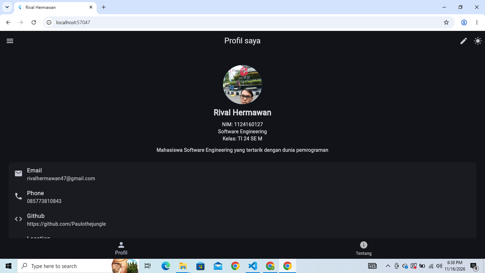
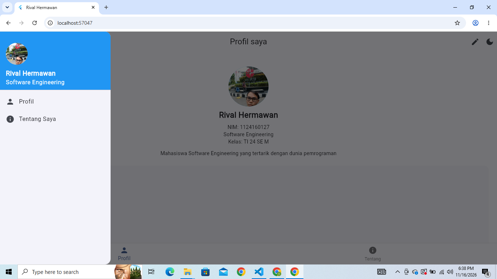

# 📱 Profile App - Flutter

Aplikasi profil pribadi berbasis Flutter dan Dart yang dikembangkan untuk memenuhi tugas Ujian Tengah Semester (UTS) mata kuliah Pemrograman Mobile.

## 📖 Tentang Aplikasi

Profile App merupakan aplikasi sederhana untuk menampilkan dan mengelola informasi profil pribadi. Aplikasi ini menyediakan fitur pengeditan data profil, informasi hobi dan pendidikan, navigasi halaman, serta pilihan tema terang dan gelap.

## ✨ Fitur Aplikasi

1. **Profile Page** — Menampilkan foto, nama, NIM, program studi, kelas, bio, dan informasi kontak.
2. **Edit Profile** — Mengubah informasi profil dengan validasi form.
3. **About Page** — Menampilkan hobi, minat, dan riwayat pendidikan.
4. **Drawer Navigation** — Menyediakan navigasi melalui menu samping.
5. **Bottom Navigation Bar** — Memudahkan perpindahan halaman Profil dan Tentang Saya.
6. **Light & Dark Mode** — Mengubah tampilan aplikasi ke mode terang dan gelap.

## 🛠️ Teknologi yang Digunakan

- Flutter
- Dart
- Visual Studio Code
- Material Design

## 📸 Screenshots Aplikasi

### 1. Profil Saya

Menampilkan informasi pribadi pengguna, termasuk foto profil, nama, NIM, program studi, kelas, bio, dan informasi kontak.



### 2. Edit Profil

Halaman untuk mengubah informasi profil pengguna dengan menggunakan form dan validasi input.



### 3. Tentang Saya

Menampilkan informasi hobi, minat, dan riwayat pendidikan pengguna.



### 4. Dark Mode

Tampilan aplikasi ketika menggunakan tema gelap.



### 5. Drawer Navigation

Menampilkan menu navigasi samping yang berisi informasi pengguna dan pilihan halaman.



## 🎥 Video Demonstrasi

Video demonstrasi aplikasi dapat dilihat melalui YouTube pada tautan berikut:

**[Tonton Video Demonstrasi Profile App](https://youtu.be/dpjzTYwhG08?si=OEdIZfYaL1EPJWJz)**

Video mencakup:
- Penjelasan fitur aplikasi.
- Navigasi antarhalaman.
- Proses edit profil.
- Penggunaan Light dan Dark Mode.
- Penggunaan Drawer Navigation.

## 🚀 Instalasi dan Menjalankan Aplikasi

### Persyaratan

Pastikan perangkat sudah memiliki:
- Flutter SDK
- Dart SDK
- Visual Studio Code atau IDE lain yang mendukung Flutter
- Browser atau perangkat Android untuk menjalankan aplikasi

### 1. Clone Repository

```bash
git clone https://github.com/Paulothejungle/uts_aplikasi_mobile
```

### 2. Masuk ke Folder Project

```bash
cd NAMA_PROJECT
```

### 3. Install Dependencies

```bash
flutter pub get
```

### 4. Periksa Konfigurasi Flutter

```bash
flutter doctor
```

### 5. Jalankan Aplikasi

Untuk menjalankan aplikasi:

```bash
flutter run
```

Untuk menjalankan melalui browser Chrome:

```bash
flutter run -d chrome
```

## 📂 Struktur Folder

```text
project/
│
├── assets/
│   └── images/
│       └── rival.jpeg
│
├── lib/
│   ├── main.dart
│   │
│   ├── models/
│   │   └── profile.dart
│   │
│   ├── screens/
│   │   ├── profile_page.dart
│   │   ├── edit_profile_page.dart
│   │   └── about_page.dart
│   │
│   └── widgets/
│
├── pubspec.yaml
└── README.md
```

## 📚 Cara Menggunakan Aplikasi

1. **Membuka Profil:** Saat aplikasi dijalankan, halaman Profil Saya akan ditampilkan.
2. **Mengedit Profil:** Tekan ikon pensil pada bagian kanan atas untuk membuka halaman Edit Profil.
3. **Menyimpan Perubahan:** Ubah informasi yang diinginkan, kemudian tekan tombol Simpan.
4. **Melihat Tentang Saya:** Pilih menu Tentang pada Bottom Navigation Bar atau Drawer.
5. **Menggunakan Dark Mode:** Tekan ikon tema pada AppBar untuk mengganti tampilan terang atau gelap.
6. **Menggunakan Drawer:** Tekan ikon menu di kiri atas untuk membuka navigasi samping.

## 👨‍💻 Developer

| Informasi | Keterangan |
|---|---|
| Nama | Rival Hermawan |
| NIM | 1124160127 |
| Program Studi | Software Engineering |
| Kelas | TI 24 SE M |
| Institusi | Global Institute |

## 📝 Catatan

- Data profil disimpan sementara menggunakan variabel di dalam aplikasi (in-memory).
- Aplikasi belum menggunakan database.
- Project dikembangkan sebagai bagian dari tugas Ujian Tengah Semester (UTS).

---

© 2026 - Profile App | Flutter Project